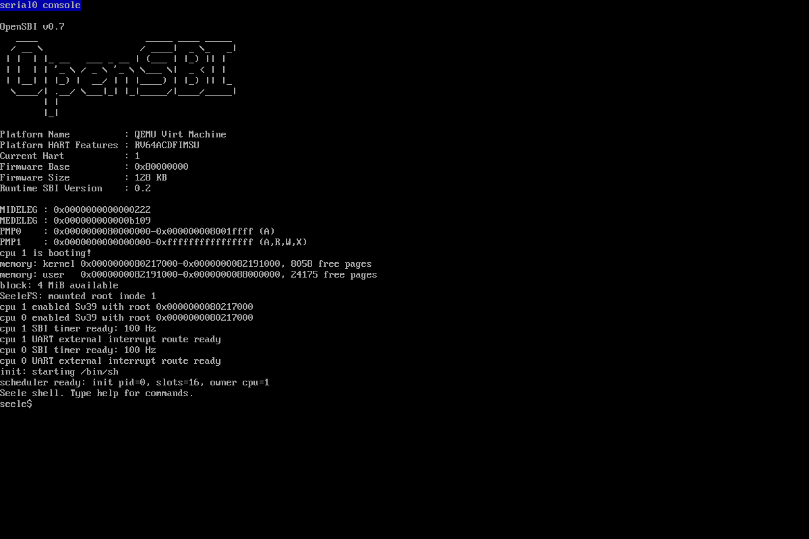

# Lab 9 · 文件管理与 Shell

Seele 从文件系统加载用户态 `/bin/sh`。Shell 提供文件与目录操作，通过 `fork → exec → wait` 运行磁盘上的独立程序。课程依据为用户提供的实验概览，详细课件待核实。见 [规格](patches/lab9.yaml) 和 [实验报告](docs/lab-9-report.md)。

~~~bash
make CONFIG=riscv64-qemu-virt-sbi build
make CONFIG=riscv64-qemu-virt-sbi run
python3 tools/test_lab9.py
make CONFIG=riscv64-visionfive2-uboot build image
~~~

首次运行创建 `build/riscv64-qemu-virt-sbi/seele-shell.img`，之后复用镜像。`DISK=/路径/镜像.img` 指定已有镜像。按 Ctrl-A 后按 X 退出。磁盘或 `/bin/sh` 无法加载时启动内嵌的 Lab 6 演示。VF2 V1.3B 同时通过 ELF/FIT 构建和板端 RAM 启动，四核与内嵌用户态程序运行正常。配置独立的 4 MiB SeeleFS GPT 测试分区后，VF2 可从 microSD 挂载并加载用户态 Shell。见 [基础实机验收](docs/lab-9-evidence/vf2-2026-11-17/README.md) 和 [SD 存储验收](docs/lab-9-evidence/vf2-sd-2026-11-17/README.md)。

~~~text
seele$ mkdir /notes
seele$ cd /notes
seele$ write report "hello world"
seele$ append report again
seele$ cat report
hello world
again
seele$ echo "external command"
external command
~~~

其他内置命令为 `help`、`ls [path]`、`pwd`、`rm path` 和 `sync`。可用绝对或相对路径启动程序，裸命令名在 `/bin` 查找。命令行支持引号、反斜杠、退格和 Ctrl-C 取消输入。

QEMU 验证了描述符与打开对象耗尽、fork/dup 共享偏移、退出释放引用、坏用户指针、exec 正常替换和失败保留、520 字节数据跨扇区及重启持久化。旧镜像回退场景通过 Lab 6 扩展验收。

[验收结果](docs/lab-9-evidence/results.json) · [串口命令](docs/lab-9-evidence/commands.txt) · [重启](docs/lab-9-evidence/restart.txt) · [Lab 8 README](docs/lab-8-baseline.md)

