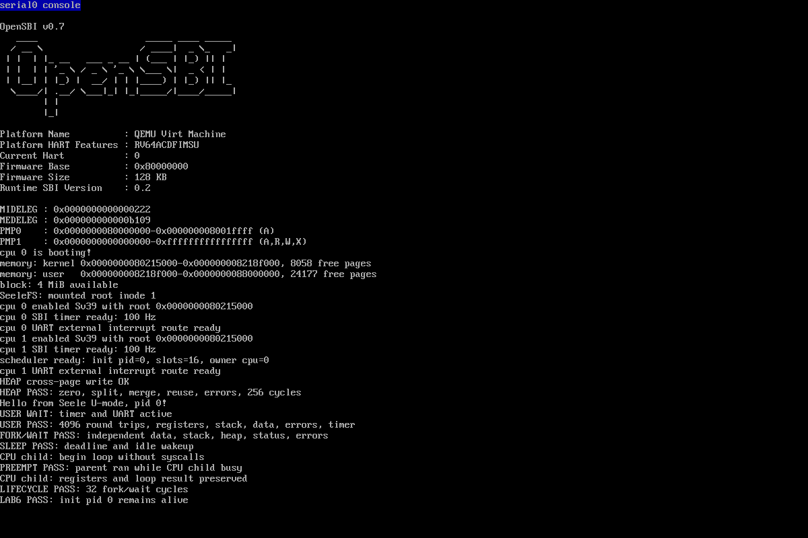

# Lab 8 · inode、目录项与路径

实现 SeeleFS v1。主机制作镜像，内核挂载后通过 inode、位图和固定目录项支持目录遍历、路径解析、文件和目录创建删除、偏移读写及截断。课程依据为用户提供的实验概览，详细课件待核实。见 [规格](patches/lab8.yaml) 和 [实验报告](docs/lab-8-report.md)。

~~~bash
make CONFIG=riscv64-qemu-virt-sbi build
make CONFIG=riscv64-qemu-virt-sbi run
python3 tools/test_lab8.py
make CONFIG=riscv64-visionfive2-uboot build image
~~~

QEMU 默认 `build/riscv64-qemu-virt-sbi/seele-fs.img` 首次生成后复用，包含 `/etc/motd`；使用 `DISK=/绝对路径.img` 可挂载已有文件。`python3 tools/mkfs.py 路径` 只创建新镜像。QEMU 用 Ctrl-A 后按 X 退出。

- 路径覆盖绝对/相对、重复斜杠、点和双点、尾斜杠、缺失父目录、非目录和超长分量。
- 6144 字节文件跨扇区读写、截断和重启内容一致；32 扇区磁盘上的短写、全盘后回收、127 个可用 inode 用尽和复用通过。
- 主机解析并核对位图与 inode 的扇区归属。坏超级块拒绝挂载且镜像逐字节不变；QEMU 原有进程及 UART 正常。
- VisionFive 2 ELF/FIT 构建通过。该平台暂无磁盘后端，未上板。

[验收结果](docs/lab-8-evidence/results.json) · [重启证据](docs/lab-8-evidence/case-2.txt) · [Lab 7 README](docs/lab-7-baseline.md)

