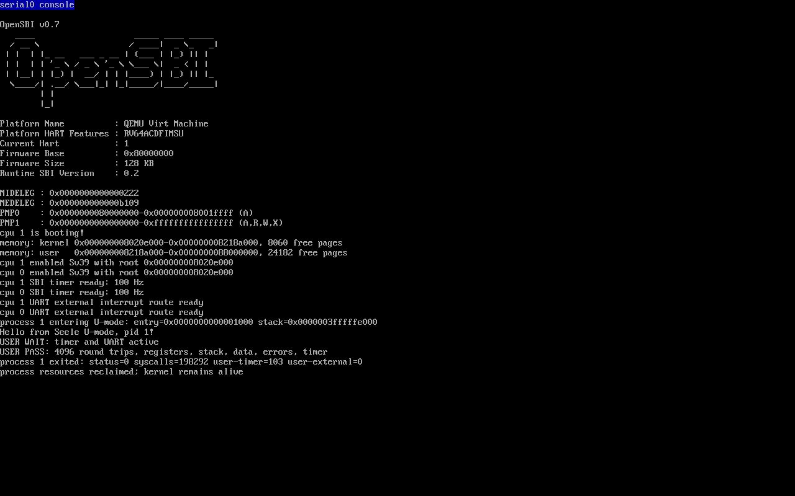

# Lab 4：第一个用户态进程的诞生

在 Lab 3 的中断、物理页池和 Sv39 基础上，创建独立用户地址空间，通过 `swtch`、trampoline 和 `sret` 进入 U-mode，再以 `ecall` 调用内核并返回。实验采用先规格、后实现的流程。

详细过程与验收见 [实验报告](docs/lab-4-report.md)，规格入口为 [design.yaml](design.yaml) 和 [Lab 4 增量](patches/lab4.yaml)。这些规格依据课件及现有 Seele 接口自行编写；课件未附固定 syscall ABI。

## 实现内容

- PCB 包含 pid、pgtbl、heap_top、ustack_pages、tf、kstack、ctx，并记录进程状态与 owner CPU。
- 首进程固定在启动核运行；其余核继续处理内核中断，没有多进程调度。
- `swtch` 保存 ra、sp、s0–s11；用户 trapframe 保存全部整数寄存器和进入内核所需的 satp、栈、handler、hart、gp。
- 内核态使用 `kernel_vector`；用户态使用两套页表同址映射的 trampoline。切换时关闭中断、刷新 TLB，并恢复正确的内核 sp/gp/tp。
- 用户程序在独立页表中运行；空页、内核 DRAM 和 MMIO 不对用户开放。用户故障结束该进程，内核继续服务 UART/时钟。
- 进程退出后先切回启动栈，再释放私有物理页和页表，并检查两个页池计数恢复。

## 用户地址空间

上界 `VA_MAX = 1UL << 38`，页大小为 4096 字节。

| 区域 | 起始 VA | 权限 |
| --- | --- | --- |
| 空页 | 0 | 未映射 |
| 用户代码与只读常量 | 0x1000 | R/X/U |
| 用户数据 | 0x2000 | R/W/U |
| 堆起点 | 0x3000 | 本实验不映射或增长 |
| 内核栈下方 guard | 0x3fffffb000 | 未映射 |
| 进程内核栈 | 0x3fffffc000 | R/W，U=0 |
| 单页用户栈 | 0x3fffffd000 | R/W/U |
| trapframe | 0x3fffffe000 | R/W，U=0 |
| trampoline | 0x3ffffff000 | R/X，U=0 |

初始用户 sp 为 trapframe 边界，向下使用用户栈。内核栈和 trampoline 在内核表中也有对应高地址映射，trapframe 在内核 C 中通过物理恒等映射访问。页表不包含用户可访问的内核恒等映射。

## 系统调用

自建 ABI：a7 为编号，a0–a2 传参，a0 返回有符号结果。

| 编号 | 调用 | 行为 |
| --- | --- | --- |
| 1 | write(fd, address, count) | fd=1，最多 256 字节，返回写入数 |
| 2 | getpid() | 返回 1 |
| 3 | ticks() | 返回本核已处理的时钟中断数 |
| 4 | exit(status) | 切回内核启动上下文，回收进程 |

write 先验证完整范围的 U/R 权限，再从物理别名复制到内核缓冲区，避免直接解引用用户指针。错误码为 -9（fd）、-14（用户地址）、-22（长度），未知调用返回 -38。普通中断保留 epc；ecall 后 epc 增加 4。

## 启动与运行

```text
OpenSBI → _entry → start → main
  全局：页池 → 内核表及 trampoline 映射 → 启动从核 → 发布 started
  每核：satp/stvec/PLIC/TIME → 开启中断
  启动核：proc_make_first → proc_run → swtch
         → trap_user_return → user_return → sret → U-mode
  系统调用：ecall → user_vector → 内核 satp/sp/gp/tp
           → trap_user_handler → syscall_dispatch → 返回用户
  退出/故障：proc_finish → swtch → 启动栈 → proc_destroy → 内核等待中断
```

```bash
cd ~/Work/Seele
make CONFIG=riscv64-qemu-virt-sbi build
make CONFIG=riscv64-qemu-virt-sbi run
```

退出 QEMU：Ctrl-A，松开后按 X。用户程序启动后执行寄存器、栈、数据和系统调用演示，等待 100 个时钟节拍后退出；此后输入仍由内核中断回显。

```text
process 1 entering U-mode: entry=0x0000000000001000 stack=0x0000003fffffe000
Hello from Seele U-mode, pid 1!
USER WAIT: timer and UART active
USER PASS: 4096 round trips, registers, stack, data, errors, timer
process 1 exited: status=0 syscalls=208845 user-timer=102 user-external=6
process resources reclaimed; kernel remains alive
```

计数受运行时机影响。上方计数来自正式回归；下方截图为另一次正式运行，由 QEMU 原生 screendump 采集。



## 验证结果

- QEMU 5.1.0 双核构建、真实 U-mode 和 4096 次系统调用往返通过；入口 0x80200000。
- 用户时钟与 UART 中断通过；退出后 5777 字节 UART 输入逐字节匹配，含长串、NUL、高位字节、CR/LF 和空闲恢复。
- 10 类保护与异常测试通过，故障进程结束后内核继续回显。
- 10 个分配失败点回滚、32 次重复创建/销毁、权限布局及 copyin 边界通过。
- 所有临时内核探针已按原始字节恢复并重建，正式 ELF 无测试探针符号。
- VisionFive2 ELF/FIT 构建及镜像识别通过，入口 0x40200000；Lab 4 未上板。

可在 Ubuntu 复现：

```bash
python3 tools/test_lab4.py
python3 tools/test_lab4.py --extended
make CONFIG=riscv64-visionfive2-uboot build image
```

`--extended` 会临时修改测试涉及的源码，并在 finally 中恢复、核对 SHA-256、重建；不要同时编辑这些文件。测试产物写入被 Git 忽略的 build/lab4-checks，精选证据保存在 [docs/lab-4-evidence](docs/lab-4-evidence)。

## 代码结构与范围

```text
kernel/proc/                     PCB 生命周期和系统调用
kernel/mm/user.c                 用户映射与 copyin
arch/riscv64/user_trap.c          用户陷阱和返回状态
arch/riscv64/trampoline.S         页表切换与用户寄存器现场
arch/riscv64/switch.S             内核上下文切换
arch/riscv64/include/asm/usertrap.h  C/汇编共用现场偏移
user/                            用户程序及链接脚本
modules/                         模块函数契约
```

本实验只保存整数上下文，用户 FS/VS 关闭；不实现浮点/向量现场、多进程调度、fork/exec、文件系统、动态堆或缺页恢复。中断处理和有界系统调用期间保持 SIE=0，不支持嵌套中断。

已有 Lab 3 README 和上板结果完整保存在 [Lab 3/VisionFive2 基线归档](docs/lab-3-vf2-baseline.md)。既有 mkimage FIT 打包修复保持原内容；旧版硬件运行结果不作为本次用户态上板验收。
