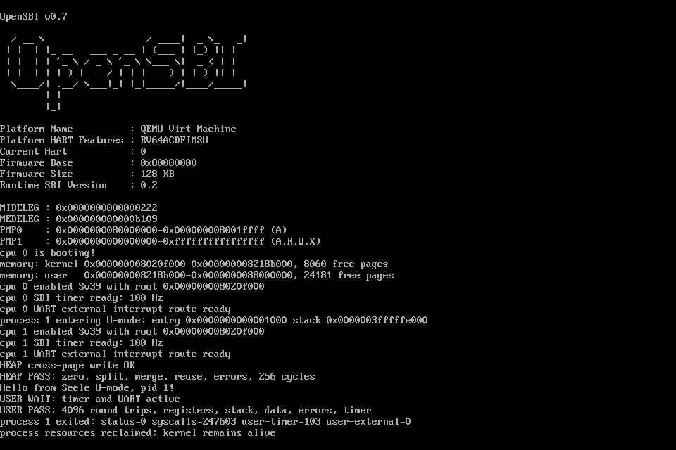

# Lab 5：用户堆管理与带参数系统调用

在 Lab 4 的真实 U-mode、Sv39 用户页表和通用 `ecall` 路径上，实现可反复分配、拆分和合并的用户堆。空闲区按虚拟地址排序，节点来自内核全局仓库；实际页面来自用户物理页池。

详细原理、实现与测试见 [实验报告](lab-5-report.md)。规格为 [design.yaml](../design.yaml)、[堆模块合同](../modules/user-heap.yaml) 和 [Lab 5 增量](../patches/lab5.yaml)。课程 PDF 没有规定具体地址、容量、调用编号或配套源码，这些依据现有 Seele 接口自行设计。

## 实现内容

- PCB 的 `mmap` 指向空闲虚拟区链表，节点记录 `begin/npages/next`；128 个节点由带锁全局仓库按需提供。
- 分配采用首次适配，也支持严格指定页地址；覆盖前部、中部、尾部和整块分配。
- 释放允许已分配区的连续子区间；覆盖孤立插入、左合并、右合并、双向合并。
- 立即分配清零物理页，映射为 R/W/U、不可执行；释放清除 PTE、刷新本核 TLB、归还物理页并回收空页表。
- 元数据和页分配失败时保留原状态；进程退出或故障统一回收剩余堆页面与链表节点。
- 延续原有寄存器传参、`write` 缓冲区验证及用户/内核陷阱返回路径。

## 地址空间与接口

页大小 4096 字节，堆为 `[0x3000, 0x1003000)`，共 4096 页、16 MiB。只初始化一个描述空闲堆的节点，物理页按需立即分配。`heap_top` 表示固定堆上界；空闲链表负责复用内部空洞。代码、数据、单页用户栈、内核栈、trapframe、trampoline 布局继承 Lab 4。

| 编号 | 接口 | 参数与返回 |
| --- | --- | --- |
| 1 | write(fd, address, count) | a0/a1/a2；fd=1，最多256字节；返回字节数 |
| 2/3/4 | getpid / ticks / exit | 继承 Lab 4 |
| 5 | mmap(address, npages) | a0=0 首次适配，否则严格指定地址；a1=页数；返回 VA |
| 6 | munmap(address, npages) | a0=页对齐地址，a1=页数；成功返回0 |

所有调用以 a7 为编号、a0 为有符号结果。堆错误为 `-22`（零页数、非法对齐、越界、溢出、释放范围有空洞等）或 `-12`（无可用区间、物理页/页表页/节点不足）。不会覆盖已有映射；失败没有部分释放或部分分配。释放若需新节点但仓库耗尽，会返回 `-12` 并保留原映射，调用者可改为释放与现有空闲区相邻的范围。

## 启动与运行

```bash
cd ~/Work/Seele
make CONFIG=riscv64-qemu-virt-sbi build
make CONFIG=riscv64-qemu-virt-sbi run
```

退出：Ctrl-A，松开后按 X。正式程序先测试多页清零、跨页 write、部分释放、首次适配复用、固定地址、错误参数和256轮分配/释放，再执行原4096次寄存器往返、时钟/UART测试，最后带着3页未显式释放的堆退出，验证进程回收。

```text
HEAP cross-page write OK
HEAP PASS: zero, split, merge, reuse, errors, 256 cycles
Hello from Seele U-mode, pid 1!
USER WAIT: timer and UART active
USER PASS: 4096 round trips, registers, stack, data, errors, timer
process 1 exited: status=0 syscalls=122303 user-timer=109 user-external=5
process resources reclaimed; kernel remains alive
```

计数因运行时机变化。截图是另一次正式运行的 QEMU 原生 screendump；没有把日志重新绘制为截图。



## 验证

```bash
python3 tools/test_lab5.py
python3 tools/test_lab5.py --extended
make CONFIG=riscv64-visionfive2-uboot build image
```

- QEMU 双核严格构建运行；入口 `0x80200000`。用户堆256轮、4096次原寄存器往返和用户时钟/UART通过，退出后5777字节串口逐字节回显。
- 独立位图模型1024步检查空闲链表、映射、权限、数据和节点计数；整堆4096页分配/释放及各拆分合并分支通过。
- 128节点耗尽、8个堆分配失败点回滚、32次带堆生命周期、完整范围预检查通过。
- 真实释放后 load/store 分别触发故障13/15；堆执行故障12。继承 Lab 4 的10类保护故障与10个进程创建失败点均通过，故障后内核继续服务。
- 临时测试在 finally 中恢复、核对 SHA-256 并重建；正式 ELF 无探针符号。证据见 [docs/lab-5-evidence](lab-5-evidence)。
- VisionFive2 严格 ELF/FIT 构建和镜像识别通过，入口 `0x40200000`；本阶段未上板。

扩展测试会短暂修改 main/proc/page/init，请勿同时编辑这些文件；原始日志在被 Git 忽略的 `build/lab5-checks/`。

## 模块与范围

| 文件 | 职责 |
| --- | --- |
| kernel/mm/heap.c | 节点仓库、区间分配/释放/合并、堆销毁 |
| kernel/mm/user.c | 整范围预检查、用户物理页解除映射与归还 |
| arch/riscv64/mm/sv39.c | 空的私有中间页表回收 |
| kernel/proc/proc.c | 创建、退出与故障的堆生命周期 |
| kernel/proc/syscall.c | 新接口参数分派和返回值 |
| user/init.S | 真实用户态演示及检查 |
| tools/test_lab5.py | 主机验收、故障与失败注入、恢复 |

这是按页的匿名私有堆接口；本阶段不实现字节级 malloc/free、完整 POSIX mmap、文件映射、懒分配、brk、多进程或调度。每个地址空间仍限 owner 核运行，内核处理期间关本核中断；大请求是有界同步操作，不保证实时延迟。未来支持进程迁移或并发页表访问时，需要补充进程内存锁及远程 TLB shootdown。

前一阶段文档见 [Lab 4 README归档](lab-4-baseline.md) 与 [Lab 4详细报告](lab-4-report.md)。
