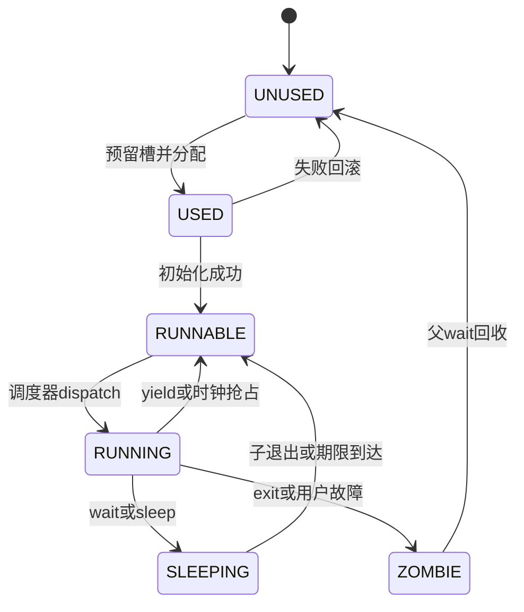
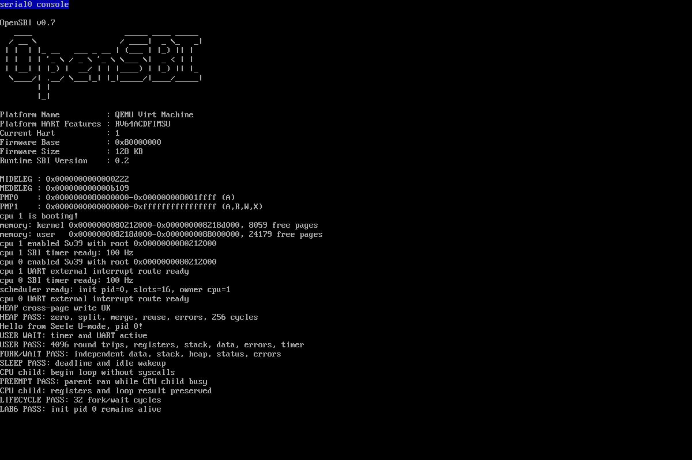

# Lab 6：进程管理模块实验报告与知识讲解

日期：2026-11-03。代码仓库：Ubuntu `/home/selvori/Work/Seele`，分支 `lab-6`；基线为 `lab-5/822bc1c724419ef6d1ff76490e4dff4534bf5c5f`。

## 1. 课件要求与实现边界

已阅读 `E:/上课/操作系统/实验/lab-6.pptx` 全8页，并检查第5页PCB/地址空间图和第7页轮转示意图。任务内容如下。

| 课件位置 | 教学要求 | 实现位置 |
| --- | --- | --- |
| 第3–4页 | 理解context和swtch；用PCB数组解耦创建与调度；只选择runnable进程 | proc.h、proc.c、switch.S |
| 第5页 | fork复制地址空间、堆链表与上下文，设置父进程和子返回值 | proc_fork、user_heap_clone |
| 第5–6页 | UNUSED/RUNNABLE/RUNNING/SLEEPING/ZOMBIE状态转换 | enum proc_state、调度与生命周期 |
| 第6页 | wait等待并回收僵尸；无退出子进程则睡眠在自己通道 | proc_wait、proc_sleep、proc_wakeup |
| 第6页 | sleep使用tick地址通道，按节拍与期限唤醒 | proc_sleep_ticks、proc_tick |
| 第6页 | exit成为僵尸并唤醒父进程，由父进程回收 | proc_finish、proc_wait |
| 第7–8页 | 时钟中断抢占和轮转，多次fork测试，0号进程永不退出 | user_trap.c、timer.c、用户演示与验收 |

课件没有提供新YAML或规定容量、系统调用编号、时间单位、孤儿策略及SMP同步方案。本项目按现有接口选择16个槽、128个共享堆节点、100Hz owner节拍、立即深拷贝，以及PID0收养孤儿。配套Spec沿用Lab4/5自建体系，先完成函数pre/effects/post并签署提交 `7eadd85`，再编码。

用户进程全部固定在启动核，其他核处理UART和时钟中断。轮转发生在用户时钟陷阱以及显式yield/阻塞/退出路径，内核服务期间保持IRQ关闭。这与课件第8页“当前仅用户态响应调度时钟”的阶段一致。

## 2. 从Lab5到Lab6的具体过程

### 2.1 检查基线与创建分支

1. 完整阅读本地AGENTS、项目规范、课件与真实README/源码。
2. SSH核对个人origin、当前lab-5、干净工作区及最近提交。
3. 执行 `python3 tools/test_lab5.py`：原用户堆256轮、4096寄存器往返、用户时钟/UART、退出后5777字节回显通过。
4. 执行 `git switch -c lab-6 lab-5`，原lab-5保持不变。
5. 写明进程、内存与系统调用合同，先签署规格提交。

### 2.2 重构进程与调度

Lab5只有一个静态PCB、一个boot context和“一次运行后销毁”的流程。本次改为16槽数组、scheduler context和无限调度循环。PID与槽位分离，init为PID0，子PID递增；回收后槽可复用。

新增state、parent、chan、deadline、switches等字段。各槽内核栈别名为 `USER_KSTACK - 2*PAGE_SIZE*slot`，向下留一页guard。共享内核高地址页表的拓扑已由启动期trampoline映射建立；只有owner访问这些可变叶子。

`proc_make_first()`只完成分配并标记RUNNABLE，main随后永久进入调度器。创建失败则销毁未发布PCB。内部USED表示分配中的槽；用户可见的生命周期仍是课件中的五种状态。

### 2.3 完成深拷贝fork

复用基础资源分配，再复制代码页、数据页、用户栈、用户trapframe、已映射的堆页及整个空闲区链表。代码保持RXU，数据/栈/堆保持RWU/NX；特权页保持U=0。子进程拥有独立页表和内核栈，仅trampoline物理代码共享。

父进程已经在ecall处理路径中把epc加4，因此复制的epc指向fork后第一条指令。子saved a0置0，父返回子PID。新内核context从 `trap_user_return` 开始，sp指向子内核栈顶；父内核调用栈不含可直接复用的子继续点。

先成功分配和复制，再设置parent/PID并发布RUNNABLE。失败时子进程从未获得CPU，统一释放它已经分配的帧、表和元数据；父映射及空闲链表保持原值。

### 2.4 完成阻塞、退出与回收

`proc_sleep(chan)`在IRQ关闭时先记录通道和SLEEPING，再切回scheduler。wait用父PCB地址作通道；sleep用owner节拍变量地址作通道。恢复后清理chan。

exit记录32位状态、转ZOMBIE并唤醒父进程；它保留资源。wait找到僵尸后，向用户地址安全写状态并在父进程栈上销毁子进程。孤儿在父退出时改挂init，已成为僵尸的孤儿也唤醒init。PID0的exit返回-1，正式程序通过后永久睡眠；PID0自身故障通过panic暴露。

### 2.5 接入时钟抢占

SBI TIME仍先重新预约并统计每核tick，然后仅owner更新睡眠时钟、检查到期进程。用户时钟处理完成后调用yield；内核态时钟处理只计数与唤醒，返回原内核现场。

调度器恢复后把current清空，再继续扫描后续槽，数组末尾回到开头。进程yield后保持RUNNABLE；等待条件时保持SLEEPING；退出后保持ZOMBIE，只有RUNNABLE会再次dispatch。

### 2.6 问题定位与修正

- 首次构建使用了仓库没有定义的int64别名，依据实际types.h改用int64_t，严格编译通过。
- 主机验收脚本生成GAS宏时多加了一次反斜线替换，Python语法检查立即发现；去掉多余替换后运行。该错误未进入内核。
- 两次fork的初版测试在新子进程中沿用了父进程已有的子计数，导致多wait；按实际父子关系把新子计数置零后，四进程场景通过。
- copyout负向探针改为先保存真实前缀、失败后逐字节比较，避免对测试填充值作错误假设。
- 验收结果文件分别保存普通与扩展结果，原始日志始终留在忽略的build目录；提交证据统一UTF-8/LF并去除行尾空白。

### 2.7 验收与归档

完成正式用户演示、单owner UART、多个进程树/睡眠/故障场景、逐分配点失败与节点/槽耗尽、异步寄存器验证。所有临时修改均在finally中按原字节恢复，核对SHA-256并重新构建。

两平台执行make -B全量严格构建；VF2执行build image与dumpimage检查。通过QEMU serial vc和monitor screendump取得真实1200×800画面，仅从PPM转PNG。README、Spec、报告、证据与截图一并进入lab-6；本地副本用于查阅，开发始终在Ubuntu仓库。

## 3. 操作系统知识：一个进程到底保存了什么

### 3.1 PCB是内核维护的进程事实

CPU只能执行当前指令流，PCB保存“暂时没有CPU”的进程所需的信息：PID、状态、父进程、页表、内存所有权、trapframe、内核context、内核栈和睡眠条件。数组只是查找方式；调度器依靠state判断谁具备运行资格。

RUNNABLE表示具备资源且在等待CPU；RUNNING表示正在owner核执行；SLEEPING表示等待一个条件，不参与竞争；ZOMBIE表示执行结束、状态仍待父进程读取；UNUSED表示槽可用于新进程。



### 3.2 trapframe与context服务于不同恢复点

| 保存区 | 保存内容 | 何时使用 |
| --- | --- | --- |
| user_trapframe | 用户x0–x31、epc、进入内核需要的可信satp/sp/gp/tp等 | 中断/ecall进入及sret返回 |
| context | ra、sp、s0–s11 | 内核中调用swtch，恢复一段内核调用链 |
| kernel_trapframe | 内核整数现场及sepc/sstatus/scause/stval | 内核态中断后的原位置返回 |

异步中断可能发生在用户任何指令，全部整数寄存器都必须保存。swtch是普通函数调用，RISC-V调用约定允许caller-saved寄存器被破坏，因此保存ra/sp和callee-saved s0–s11足以恢复C调用链。此处sp、ra与栈上的返回地址一起决定恢复点。

例如A在wait中切走，B在定时中断中切走。以后A恢复的是wait内部 `swtch` 的下一条指令，而B恢复的是用户时钟处理里的yield继续点；各自最终再通过trapframe回U-mode。

### 3.3 为什么切换通过scheduler中转

```text
A用户指令
 → trampoline保存用户现场、切内核satp/栈
 → A的内核处理路径调用swtch(A.ctx, scheduler.ctx)
 → scheduler在启动栈上选择B
 → swtch(scheduler.ctx, B.ctx)
 → B的内核继续点
 → B的trap_user_return / sret
 → B用户指令
```

本项目内核C共用一张内核页表，因此A到scheduler到B的两次swtch只换寄存器与内核栈。返回用户时，trampoline写入B的satp并执行sfence.vma。ASID仍为0，不能省略当前实现所需的失效。

调度器独立栈使退出进程可以停止执行；父进程之后在自己的栈上释放子内核栈，避免正在使用的sp指向已归还的物理页。

## 4. 操作系统知识：fork、地址空间与资源所有权

fork提供用户观察到的同一执行位置、相同初始内存和不同返回值。子进程从fork后继续执行，且修改自己的变量不会改变父进程。

两个页表可以把相同虚拟地址映射到不同物理页。父子都用0x3000访问堆，但各自PTE指向独立物理帧。深拷贝必须覆盖可变数据、用户栈和堆；PCB里堆空闲链表是内核元数据，也要独立复制，否则子munmap会破坏父可分配区。

本次连代码页也复制，便于明确所有权；trampoline只读共享。现代系统常用COW延迟复制：父子共享只读物理帧，写故障时分裂。COW需要引用计数和缺页处理，本实验采用立即复制。

复制内核栈上的父调用链会保留指向父栈或父PCB的指针，因此本实现构造新内核context，以共享的用户返回入口启动子进程。用户现场的复制与新内核上下文的构造共同满足fork语义。

fork失败是一次事务回滚。内存帧、页表节点、空闲区节点和PCB槽任一不足，都不能让半初始化的子进程被调度。本次16个页分配失败点包括固定资源、私有中间页表、稀疏堆页和跨2MiB边界的页表分配；节点测试还覆盖只复制部分空闲链表便失败的情况。

## 5. 操作系统知识：wait、僵尸、孤儿和条件同步

### 5.1 exit与wait分担生命周期

子进程退出后，父进程仍需要读取PID和退出状态。ZOMBIE保留这份事实；本实验同时保留其全部私有资源，待wait统一释放。

wait循环先查找自己的子进程。存在僵尸则复制状态并回收；有存活子进程则睡眠；没有子进程则返回-10。唤醒仅说明“条件可能变化”，恢复后必须再次检查。父先wait和子先exit都走相同循环。

父退出时其子进程改由init收养，避免无人回收。若被收养的子进程已经是僵尸，必须唤醒正在wait的init。正式init显式回收所有演示子进程后进入睡眠；扩展场景验证两种收养顺序。

### 5.2 通道只是条件的身份

`chan`是内核指针，只用于比较相等，不是用来读写的用户缓冲区。wait使用父PCB地址命名“这个父进程有子退出”；定时sleep使用节拍变量地址命名“时间条件发生变化”。

通道唤醒把SLEEPING改为RUNNABLE，不会马上把CPU交给它。进程还要等调度器选中，所以sleep保证至少经过请求数量的已处理节拍，实际恢复可以更晚。

### 5.3 避免丢失唤醒

危险次序是：父检查“无僵尸”，子恰好退出并唤醒，但父尚未标记睡眠；随后父睡眠，之前的唤醒就丢失了。

本实现让进程表与条件只由owner访问，并在检查条件、发布SLEEPING、切换期间关闭owner IRQ。其他核的timer不修改PCB，因此此阶段没有事件能插入检查与发布之间。所有锁和push_off必须在切换前释放，proc_sched检查中断关闭嵌套深度为0。

MIT xv6将这一问题作为条件同步的核心，见[Sleep and Wakeup](https://mit-pdos.github.io/xv6-riscv-book/sleep.html)。将来允许其他核同时退出/唤醒时，需要用条件锁与进程状态锁保护这段协议；当前的单owner约束不能直接推广到SMP调度。

### 5.4 用户指针为什么要完整验证

wait的status_va是用户虚拟地址，内核C使用内核页表，不能直接把它转换成指针写入。user_copyout先检查完整范围内每页都具有PTE_U与PTE_W，再通过物理恒等别名写字节。

完整验证保证跨页地址的第二页非法时，第一页也不被部分写入；wait不会因坏指针提前消费僵尸。验证覆盖只读代码、trapframe、越界、整数溢出、可写跨页和跨空洞。32位状态按字节复制，允许未对齐地址。

## 6. 操作系统知识：时钟、抢占与轮转

### 6.1 协作调度需要抢占补足

yield与sleep依赖进程主动交出CPU。CPU密集进程可以永不调用它们。定时器通过硬件陷阱夺回控制权：TIME到期进入S-mode，保存现场并重新预约，再把当前进程改为RUNNABLE交回scheduler。

本实现每个用户时钟事件触发一次yield，owner目标100Hz，名义节拍10ms。轮转按固定槽序扫描；在可运行进程持续存在且内核服务有界时，它们获得反复执行机会。新创建或刚唤醒的槽位由下一次扫描决定等待时间。

### 6.2 中断与内核抢占的关系

硬件进入trap后清SIE。当前内核服务保持SIE=0，普通内核代码不会在持锁中间被进程调度切走。只有显式可切换位置调用proc_sched，并检查没有push_off嵌套。

内核态时钟中断通常发生在scheduler空闲或其他核的中断等待路径；它只处理设备与唤醒。用户trap使用完整trapframe，因而可以安全让出后再恢复到原用户PC。ecall固定加4，普通时钟保留epc。

### 6.3 sleep计时与真实时间

SBI预约基于time，但本接口sleep使用已处理tick数。定时处理从当前time重新预约，内核长时间关中断会使处理节拍延迟；tick不是严格墙上时间。持续其他核的tick不用于唤醒owner用户进程。

期限用64位模数差比较，单次duration限制在0x7fffffff以内。sleep(0)执行yield，非法大值返回-22。全部进程睡眠时scheduler执行WFI；本核STIE仍开，pending timer使其恢复，再打开SIE处理后重查RUNNABLE。

### 6.4 连续n次fork产生多少进程

当所有存活进程都继续执行下一次fork且每次成功时，总数为2^n，新增后代为2^n-1。两次fork得到4个进程。若父进程每次独自fork而子分支退出循环，则只得到n个子进程。PCB容量或资源不足也会改变结果。

```text
P0
├─ P1（第一次fork产生）
│  └─ P3（P1执行第二次fork）
└─ P2（P0执行第二次fork）
```

PID分配先后取决于调度，P2/P3是图中的角色名；不能仅凭数值PID推断固定创建顺序。扩展验收按父子关系分别wait，并验证所有后代都回收。

## 7. 代码导读

| 文件 | 本次变化与阅读重点 |
| --- | --- |
| include/kernel/proc.h | PCB数组容量、状态、parent/chan/deadline/context |
| kernel/proc/proc.c | 分配、深拷贝、轮转、睡眠、唤醒、僵尸、回收、收养 |
| arch/riscv64/switch.S | 复用ra/sp/s0-s11切换机制 |
| kernel/mm/heap.c | user_heap_clone深拷贝空闲链表和稀疏堆 |
| kernel/mm/user.c | 每槽内核栈映射与user_writable/user_copyout |
| arch/riscv64/user_trap.c | 用户时钟处理后yield；返回时重装每进程可信内核状态 |
| arch/riscv64/timer.c | 重新预约后调用owner proc_tick唤醒 |
| arch/riscv64/cpu.c | 查询push_off深度，阻止跨锁切换 |
| kernel/proc/syscall.c | 新ABI分派及保存返回值 |
| kernel/main.c | 创建/调度分离、永久进入scheduler |
| user/init.S | 原堆/寄存器回归及fork/sleep/preemption演示 |
| tools/test_lab6.py | 主机验收、临时探针、故障/失败注入与finally恢复 |

建议阅读顺序：proc.h → switch.S → proc_scheduler/proc_sched → user_trap.c → proc_fork → wait/sleep/exit → heap clone与copyout → 用户演示和测试。

## 8. 验收结果与复现

```bash
cd ~/Work/Seele
python3 tools/test_lab6.py --extended
make -B CONFIG=riscv64-qemu-virt-sbi build
make -B CONFIG=riscv64-visionfive2-uboot build image
riscv64-linux-gnu-readelf -h build/riscv64-qemu-virt-sbi/kernel.elf
dumpimage -l build/riscv64-visionfive2-uboot/kernel.itb
```

| 验证组 | 实际检查与结果 |
| --- | --- |
| 正式程序 | 256堆循环、4096寄存器往返；父子数据/栈/堆独立、status=37；32轮fork/wait；init持续存活 |
| 抢占 | 子进程无syscall执行200000000轮，父先恢复；累计1400000000正确，gp/tp保持 |
| 异步现场 | 两个独立CPU子进程各1亿轮，检查所有非计数整数寄存器及栈；临时断言每个至少2次timer和3次dispatch，实际计数见证据 |
| 进程树 | 先exit/先wait；存活/已僵尸孤儿；两次无条件fork的四进程；16槽耗尽-11及复用 |
| 睡眠与状态指针 | 全睡眠idle、错峰期限、sleep(0)/yield、非法duration；可写跨页状态成功，非法指针保留僵尸 |
| 用户故障 | 空页读13、代码写15、堆执行12、解除映射后读13、特权CSR2；父收到-1并继续 |
| 回滚与资源 | 16个页分配失败点、128节点耗尽与部分链表失败、逐字节深拷贝、所有槽资源回收；真实wait反复回收计数恢复 |
| UART | 用户等待/计算期间回显；每场景完成后5777字节逐字节一致；owner-only路由通过 |
| 构建 | QEMU/VF2 make -B严格编译；入口0x80200000/0x40200000；VF2 FIT payload=24972字节 |
| 恢复 | init/main/page/proc SHA-256按原字节一致，恢复后重建；正式ELF无lab4/lab5/lab6探针符号 |

扩展测试原始日志位于 `build/lab6-checks/`，精选证据位于 [lab-6-evidence](lab-6-evidence)。普通与扩展结果分别存档。测试中的实际make run以Ctrl-A/X正常退出，QEMU返回0。



## 9. 本阶段留下的接口与扩展条件

本次形成了进程状态机、独立内核context、用户地址空间生命周期和条件等待接口，为后续进程服务提供基础。SMP用户调度需要进程表/父子关系/条件锁以及一致的锁顺序；迁移与并发页表访问需要远程TLB shootdown；内核抢占还需区分不可抢占区域并管理中断嵌套。COW、exec、文件系统、浮点/向量上下文沿后续课程扩展。

本次硬件验证范围为VisionFive2 ELF/FIT构建与镜像识别；QEMU完成了运行验收。
