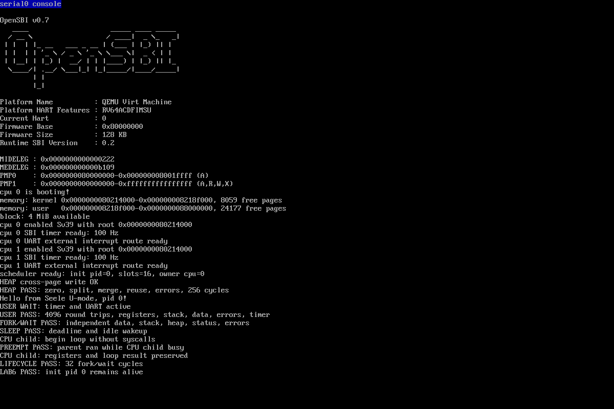

# Lab 7 · 块设备与缓冲

QEMU virt 通过 VirtIO-MMIO 连接一块 4 MiB 原始磁盘。内核提供 512 字节扇区读写、显式 flush 和 16 扇区写穿 LRU 缓存。课程依据为用户提供的实验概览，详细课件及实机要求待核实。见 [规格](../patches/lab7.yaml) 和 [实验报告](lab-7-report.md)。

~~~bash
make CONFIG=riscv64-qemu-virt-sbi build
make CONFIG=riscv64-qemu-virt-sbi run
python3 tools/test_lab7.py
make CONFIG=riscv64-visionfive2-uboot build image
~~~

QEMU 默认磁盘 `build/riscv64-qemu-virt-sbi/disk.img` 首次运行时创建，后续复用。用 `DISK=/绝对路径.raw` 可指定已有镜像。按 Ctrl-A 后按 X 退出。验收脚本使用独立探针镜像，临时改动 `main.c` 并在 `finally` 中逐字节恢复。

- QEMU 5.1.0 识别 8192 个扇区，ELF 入口 `0x80200000`。
- 验证 LRU 命中及替换、非法请求和 16 位环索引回绕。
- 两核各读写 64 扇区，主机逐字节校验，重启再读一致。
- 有盘与无盘均通过 Lab 6 正式工作负载和 5777 字节 UART 回显。
- VisionFive 2 ELF/FIT 构建通过，入口 `0x40200000`。VF2 当前无磁盘后端，未上板。

[验收结果](lab-7-evidence/results.json) · [写盘串口](lab-7-evidence/write.txt) · [重启串口](lab-7-evidence/restart.txt) · [Lab 6 README](lab-6-baseline.md)

