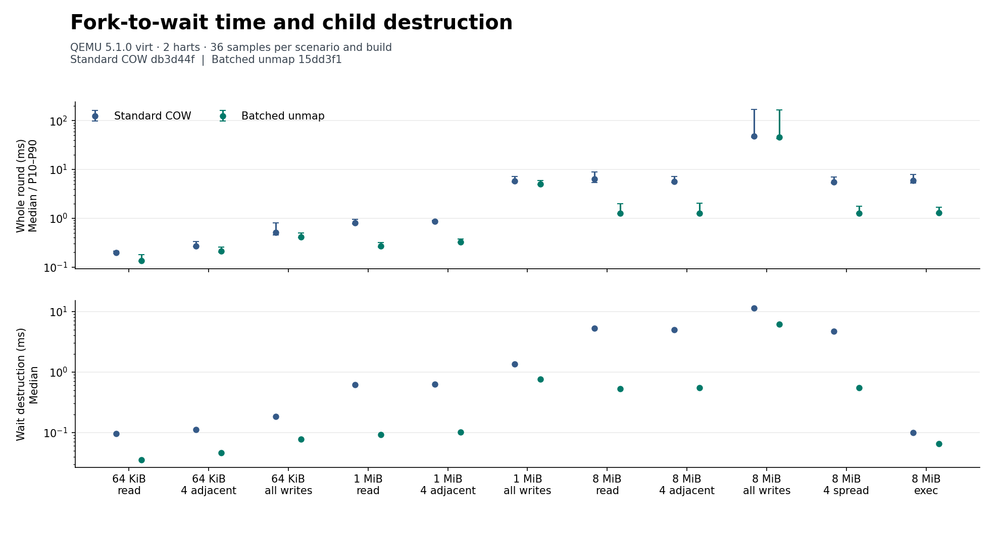
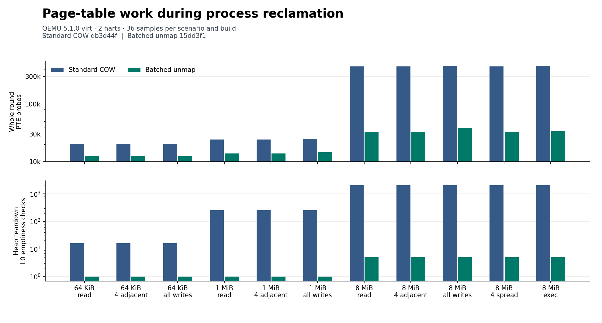

# Sv39 批量回收实验

在 QEMU 5.1.0 双 hart 上，8 MiB 只读工作集的整轮中位数从 6.388 ms 降至 1.272 ms，wait 中实际销毁从 5.271 ms 降至 0.533 ms。末级表判空从 2048 次降至 5 次。标准版和批量版均完成 11 个场景，每场景 36 个计时与 36 个独立计数样本，失败为零。

- [全场景汇总表](summary.md) · [阶段计数与标准 COW 逐表核算](measurement.md) · [配置和版本清单](manifest.json)
- [标准 COW 原始样本](raw/standard.json) · [批量撤映射原始样本](raw/batched.json) · [数据格式](schema.md)
- [复跑及离线重建](reproduce.md) · [后续机制对照报告模板](report-template.md)
- [回归结果](regression/results.json) · [用户态专项串口](regression/lifecycle-cases-serial.log) · [VisionFive 2 FIT 信息](regression/vf2-fit.txt)

## 实现和所有权

`proc_wait → proc_destroy → user_heap_destroy` 在父进程的内核栈回收僵尸。成功 exec 准备好新映像和新堆元数据后，调用同一个堆销毁函数。未公开的 fork 子进程也由 `proc_destroy` 回滚。批量例程从页表读取实际存在的叶子，能处理尚未完成的克隆及缺失的下级节点。

`user_vm_clear_heap` 按 2 MiB 末级表覆盖窗口截取堆范围。每窗口只走一次页表以定位末级表，缺失时跳过整个范围。先把范围内的有效堆 PTE 设为无效，保留其中的帧号，执行本地 `sfence.vma`，再将这些项清零并释放对应用户帧引用。该路径在关闭中断的调度 owner 核、非活动的私有用户根下运行。它用失效表项暂存帧号，无需分配工作缓冲区。其他 hart 不运行该用户地址空间。

处理完一个窗口后对整张末级表判空，保留代码和数据所在首表。摘除空节点时，先断开父表项，再刷本地 TLB，最后回收表页。部分 munmap 仍先校验完整范围及预留链表节点，再撤销映射。mmap 失败回滚继续使用原来的精确范围操作。批量销毁依赖当前单 owner、私有页表和 4 KiB 页约束。共享页表或进程迁移须另行定义引用和 TLB 协议。

## 对照结果

| 代表场景 | 标准 COW 整轮中位数 | 批量版整轮中位数 | 主要相位变化 |
| --- | ---: | ---: | --- |
| 64 KiB 只读 | 0.198 ms | 0.136 ms | wait 销毁 0.097 → 0.036 ms |
| 1 MiB 只读 | 0.795 ms | 0.266 ms | wait 销毁 0.612 → 0.092 ms |
| 8 MiB 只读 | 6.388 ms | 1.272 ms | wait 销毁 5.271 → 0.533 ms |
| 8 MiB 全量写 | 48.369 ms | 46.065 ms | wait 销毁 11.373 → 6.129 ms |
| 8 MiB 立即 exec | 5.891 ms | 1.307 ms | exec 清理旧堆 4.912 → 0.501 ms |

- 8 MiB 只读的逐表判空由 `[509, 512, 512, 512, 3]` 降至 `[1, 1, 1, 1, 1]`。末级判空读取 397052 → 2050，整轮 PTE 探查 449322 → 32843，下降 92.7%。两版均减 2048 次堆帧引用、剪枝归还 4 张表页。首张表含代码与数据，最终销毁时统一回收。缺失表跳过后，批量版只检查已存在表覆盖的 2557 个销毁槽，额外的帧释放遍历单独计入 PTE 探查。
- 8 MiB 全量写仍触发 2048 个用户写缺页并复制 8392704 字节，额外用户页峰值两边均为 2049。两组整轮 P10/P90 分别为 45.797/168.667 ms 和 42.535/166.402 ms，大幅重叠。QEMU 时间会受宿主调度影响，本轮未定位长尾来源。
- 8 MiB 集中写和分散写各写 4 页，命中 1 张和 4 张末级表。批量版两者整轮均探查 32855 次 PTE，中位数 1.267 和 1.274 ms。两组区间重叠，未观察到可归因于选址的时差。
- 立即 exec 的成本在子进程提前发生，父进程 wait 阻塞中位数 5.031 → 0.634 ms。末级表的五次批量判空均归入 exec，最终 wait 无旧堆叶子可撤。等待阻塞与 exec 清堆可以重叠。
- 批量版仍为子进程建独立表。8 MiB 只读创建中位数 0.553 ms，克隆遍历 4096 个槽，整轮仍有 32843 次 PTE 探查。后续共享页表比较应使用此批量版为对照，并单测建表、首次写入、分支撤映射及模板淘汰。

## 验证范围

先在父分支基线重跑现有生命周期回归。批量版用真实 U-mode 运行稠密工作集和四个稀疏地址 `0x1ff000 / 0x200000 / 0x401000 / 0x1002000`，覆盖 2 MiB 边界、堆末页、缺失表、共享帧和跨洞 munmap 拒绝。注入 fork 局部建表后的失败，核对父进程 PA、权限和引用均保留。八轮专项测试均恢复页池、堆节点、PCB 和打开对象余额。exec 成功与失败、跨页内核代写 OOM、RX 保护、Lab 5 位图模型和 mmap 失败、Lab 6 抢占与 UART、Lab 9 文件与重启回归均通过。

正式 ELF 入口为 QEMU `0x80200000` 和 VisionFive 2 `0x40200000`。两平台严格构建及 VF2 FIT 检查通过，QEMU 的实际运行走 `make run`。临时源码哈希恢复一致，正式 ELF 无探针。本轮未上板，结果范围为当前 QEMU 配置。
