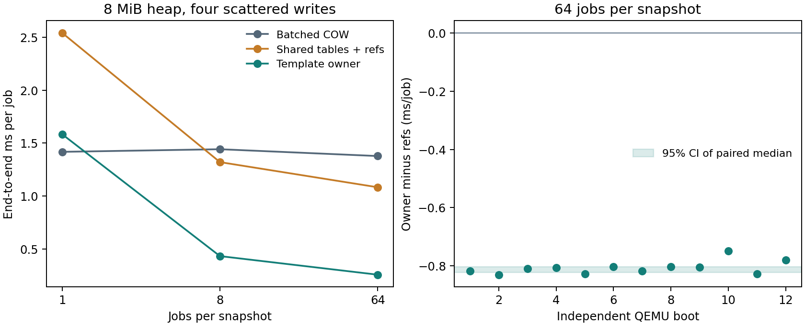

# Sv39 模板分支候选实验

截至 2026-11-18，第 5 步的内核原型和第 6 步的三路对照已完成。研究分支为 `research/template-candidate`，实验代码为 `c02395a3a90afcd700e5511fb852dc8d933ec668`，起点为 `research/process-lifecycle` 的 `b94d438`。实验支持保留这条研究路线，最终比赛机制仍待选择。

## 结论

8 MiB 匿名堆、分散写 4 页、连续派生 64 次时，模板持有路径摊销中位数为 0.3032 ms/任务，共享表逐项持有为 1.1197 ms，批量 COW 为 1.4249 ms。相对于相同模板和相同页表复制策略的逐项持有，耗时下降约 73%。每次都计入一次模板建立和最终释放。12 次独立启动的每批配对耗时差中位数为 −0.8072 ms/任务，95% bootstrap 区间为 [−0.8226, −0.8029]。该区间描述同一 QEMU 环境的批次变异。[全部数据与分项](summary.md)

两条模板路径在主场景每个分支都复制 2045 个堆表项。逐项持有额外获取 2045 个借用帧引用，退出时检查 2045 个槽位；模板持有检查 32 个位图字、释放 4 个私有帧，随后释放私有表并归还一个模板引用。两者复制量相同，给出了所有权规则自身的可观测贡献。原模型计算 2048 槽；实际首表只复制 509 个堆槽，固定映像的前三槽由常规创建路径处理，故实测为 509 + 3 × 512。位图遍历还包含字内定位和释放。逐项持有的私有帧通过表扫描一并释放，专用“私有帧释放”计数仅对位图路径有效。

## 适用边界与下一轮问题

- 同样的稀疏写负载只运行 1 次时，模板持有 1.5846 ms，批量 COW 1.4178 ms。运行 8 次时分别为 0.4321 和 1.4426 ms。该实验观察到了摊销收益转换的范围，精确交叉点取决于工作负载。
- 2 MiB 对齐且只读时，两种模板路径都直接共享完整堆表，均为零堆表复制、零借用引用增加、零退出槽扫描。N=12 的三批摊销结果为 0.348 和 0.343 ms/任务。8 MiB 全写时三条路径约为 42–44 ms，轮次分布重叠。只有预先指定的主场景进行了 12 次独立启动配对检验。
- 相对预热父进程，主场景两种模板路径的额外峰值均为 6 个用户页和 22 个内核页，批量 COW 为 5 和 11。单独的长寿分支实验中，创建者先关闭模板并撤销原堆，唯一分支覆盖全部 2048 页后仍需保持模板原始页存活。此时模板版占用 4096 个额外用户页，普通 fork 为 2048 个，相差 8 MiB。最终所有资源回到基线。[长寿分支实测](check.json)
- 最值得深挖的问题是：模板关闭后，能否按不再被任何分支借用的窗口提早归还原始帧，同时保住稀疏写的低开销？另外可评估自适应回退普通 fork，以及改良对照实现（例如批量引用维护、单独维护混合首表的有效槽位）。本实验中的逐项持有是项目内部消融对照；与 On-demand-fork、影子对象等已有系统的机制对照仍是原创性研究的一部分。

## 实现路径

| 接口或模块 | 行为 |
| --- | --- |
| SYS_FREEZE(policy) | 建立不可调度的快照，冻结匿名堆、用户寄存器与固定映像，复制空闲区间，继承文件描述和 cwd。创建者收到 1；随后派生的分支从该调用点收到 0。原创建者保持可运行并获得 COW 写保护。每个进程最多持有一个句柄。 |
| SYS_SPAWN / SYS_RELEASE | 从创建者持有的快照建立运行进程，返回子 PID；释放句柄后禁止新派生。快照槽在最后一个分支地址空间被释放后销毁。分支退出由 wait 回收；成功 exec 切换后归还旧地址空间，创建者退出或成功 exec 自动关闭句柄。分支直接 fork 返回 -95，成功 exec 后恢复原有 fork 能力。 |
| kernel/mm/template.c | Sv39 根和中层私有，纯堆末级表共享，混合首表的固定映射独立安装。首次修改先预分配需分离的页表。策略 0 在末级表私有化时逐项持有，策略 1 让模板持有原始页并用位图记录私有帧。两者使用相同一页分支元数据。 |
| kernel/mm/heap.c、user.c | 普通分配、局部解除映射、用户 store、内核跨页代写及失败回滚覆盖两种策略。在单调度 owner、用户地址空间不活动并关中断的上下文更新表项，刷新本核翻译后才允许复用物理帧。现有固定 RX 页保持只读。 |
| 资源约束 | 快照当前复用一个进程槽及相应内核资源（共 16 个槽）。每个分支的根、上层页表、陷阱帧与内核栈独立。仅支持 Seele 当前的匿名堆与固定映像；未扩展为跨核同时运行同一地址空间。文件描述引用沿用 fork，共享文件偏移。 |

## 正确性证据

两种策略都通过真实 U-mode 测试，包括八个同时存活分支对同一地址独立写入、创建者先关闭并撤销映射、跨表局部撤销及同址零页重映射、跨页文件读取写回、RX 故障、store 分配失败、exec 三个分配失败点和成功替换。在单独分支上注入跨表 munmap 两个失败点、mmap 三个失败点、跨页代写四个失败点，核对原字节与资源余额。创建和派生注入前八个页分配失败位置。八分支全量写触发物理内存压力，允许部分或全部分支因 OOM 退出，检查每个状态和最终页池、区间节点、进程槽与文件余额。[专项串口](serial/template-check-serial.log)

原生命周期专项 8 轮及历史 Lab 5/6/9 回归通过，临时代码按哈希恢复。QEMU 正式 ELF 入口为 0x80200000，VisionFive 2 ELF/FIT 构建通过、入口为 0x40200000。性能样本全部来自 QEMU，开发板尚未执行此候选协议。[回归结果](regression/results.json) · [FIT 信息](regression/vf2-fit.txt)

## 测量及复现

QEMU 5.1.0 virt，128 MiB，2 hart，单 owner 执行用户进程，RISC-V time 10 MHz，GCC 11.4.0，Linux VM。三种策略在同一模式的同一 ELF 内运行，用同一份用户二进制及输入。时间、计数、故障注入使用不同构建。原始 JSON 包含测量提交、用户程序与内核摘要、预热及每批/轮样本。批量 COW 对照为同一候选构建内的普通 fork 入口；历史基线单独保留。创建计时含 syscall 的用户侧往返，wait 销毁为内核相位，首次堆写是第一次实际 COW fault 的内核处理时间。批量 COW 的建立与关闭两列只是空计时边界。

每个矩阵场景先做 2 轮预热，再做 3 批各 12 轮；另测 N=1、8、64 摊销和 12 个独立启动的配对三路主场景。用户散列任务对预热表执行 4096 次确定性查找并校验散列；它是一项可复现的合成应用负载。基准检查父堆内容和最终各类余额，时间段不含输出串口。时间单位为 tick（100 ns），页大小 4 KiB。time/counts 的 samples 中 policy 0/1/2 顺序为普通批量 COW、逐项持有、模板持有；n=12 对应 14 个矩阵场景，boot_pairs 为独立重启的主对照。counts 中的 resident_page_ticks 为批次起点之上的额外驻留页数对 time 的积分。[时间样本](time.json) · [计数样本](counts.json) · [专项与资源余额](check.json)

在该分支的 Ubuntu 工作副本根目录，用 Python 3.10+ 执行下列命令。结果目录使用一个新的名称。图表可在安装 Matplotlib 的分析机上由同一脚本生成。

~~~sh
python3 tools/bench_template.py build/template-replay check time counts
python3 tools/report_template.py build/template-replay
python3 tools/report_template.py build/template-replay --plot
python3 tools/test_lifecycle.py --output build/template-regression-replay
~~~
